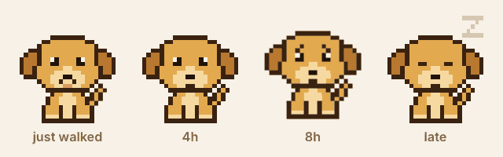
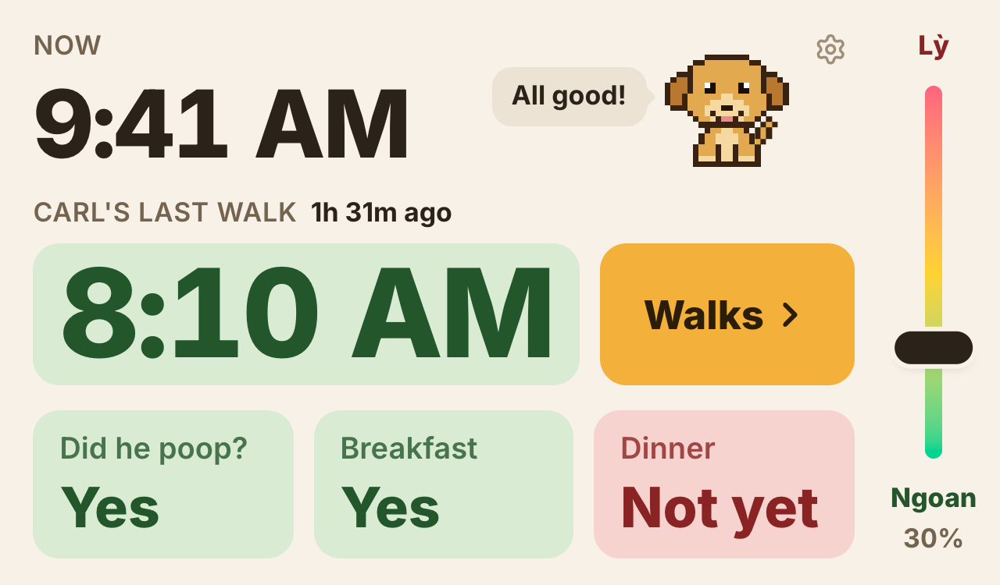
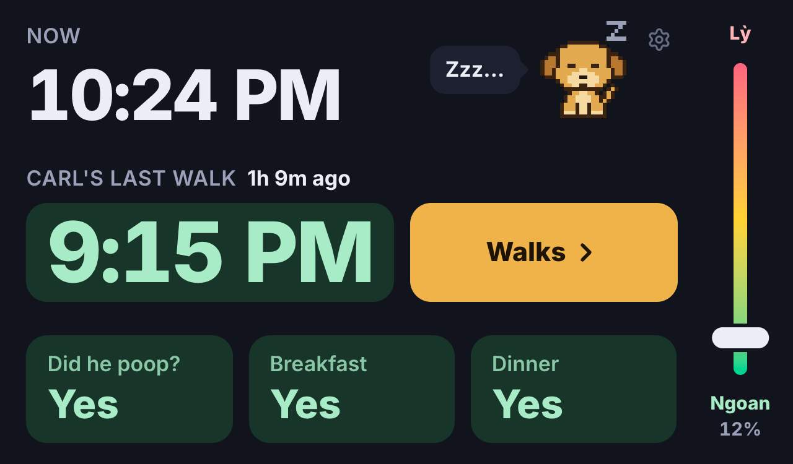
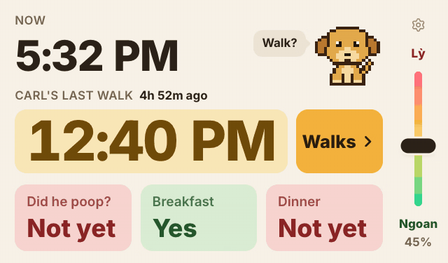

# dibo



Dog tracker for Carl. The name is from "đi bộ", which is Vietnamese for "to walk".

It runs on a Raspberry Pi with a 7" touchscreen by the door so
we can see at a glance when he was last walked and whether he's eaten and pooped
today. It syncs through Firestore, so a walk logged from another device shows up on
the screen too.

<p align="center">
  
  
</p>

The big number is when he was last walked. It goes yellow after 4 hours, orange
after 6 and red after 8, and the dog gets more restless along with it. Late at night
he falls asleep.

Tapping Breakfast or Dinner marks it done (tap again to undo), and the poop tile
fills in from the walks. The slider on the right is the lỳ meter, for how stubborn
he's being.



The day resets at 3am so a midnight walk still counts for the night before, and the
screen switches to a dark theme between 7pm and 7am.

## Development

```bash
cd dibo-tracker
npm install
npm run dev
```

It runs without Firebase, it just won't save anything. To sync, make a Firebase
project with Firestore and put the web config in `dibo-tracker/.env` (see
`.env.example`).

Walks and meals are documents in `events`, with a `type` of `di_bo` (walk),
`an_sang` (breakfast) or `an_chieu` (dinner). The lỳ meter and the dog's name are in
`state/ly` and `state/profile`.

There's no login, so lock down your Firestore rules.

## Pi

Setup is in [PI_SETUP.md](PI_SETUP.md). The Pi pulls `main` and rebuilds every time
it boots, so to deploy, push and reboot it.
